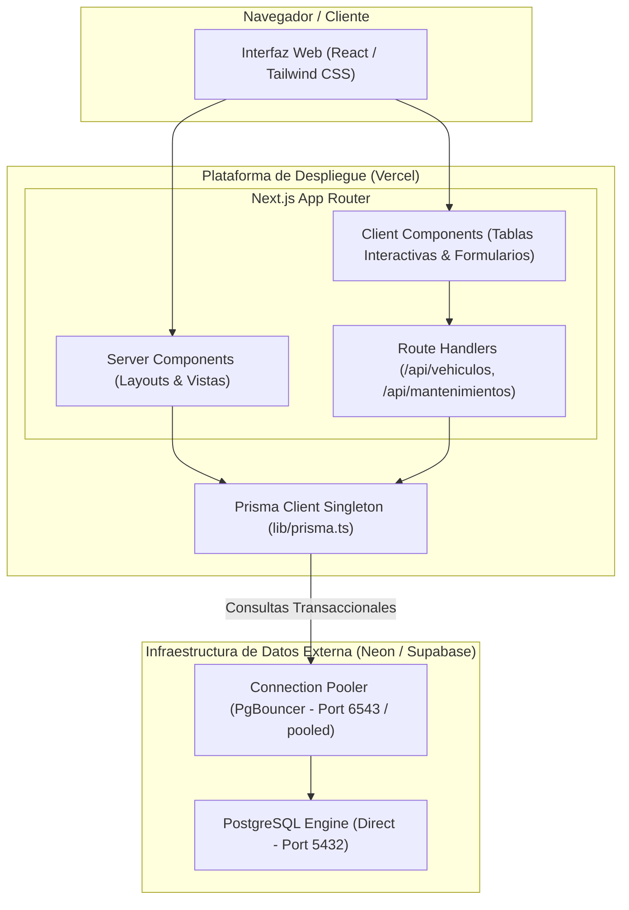
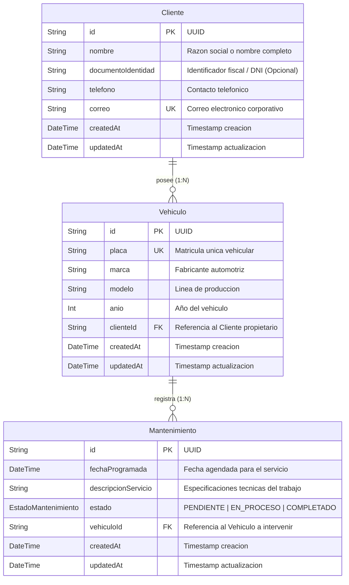

# Documento de Arquitectura de Software

## Sistema de Gestion de Mantenimiento Vehicular (AutoGest Pro)
**Version del Documento:** 1.0.0  
**Fecha de Emision:** 2026-10-28  
**Clasificacion:** Documentacion Tecnica Interna  

---

## 1. Vision General y Objetivos del Sistema

El sistema esta diseñado como una plataforma web full-stack para la administracion centralizada de clientes, flotas de vehiculos y programacion de mantenimientos tecnicos (preventivos y correctivos). Su proposito principal es garantizar trazabilidad operativa, control de estados de servicio y optimizacion de recursos bajo estandares corporativos e industriales.

### Requisitos Arquitectonicos No Funcionales:
- **Disponibilidad y Escalabilidad:** Arquitectura desacoplada y orientada a micro-ejecuciones sin estado (Serverless) sobre Vercel.
- **Rendimiento:** Carga inicial reducida mediante React Server Components (RSC) y optimizacion de paquetes.
- **Seguridad y Resiliencia:** Manejo estricto de pools de conexiones de base de datos para prevenir saturacion de conexiones en Postgres.
- **Estetica y Usabilidad:** Interfaz de usuario de grado de ingenieria, sobria, sin distracciones visuales ni elementos informales (cero emojis), con tablas densas y legibles.

---

## 2. Stack Tecnologico

| Capa | Tecnologia | Version | Justificacion Tecnica |
| :--- | :--- | :--- | :--- |
| **Framework Web** | Next.js (App Router) | 14.2.x | Enrutamiento basado en carpetas, renderizado hibrido (SSR/SSG/ISR) y funciones de servidor nativas. |
| **Lenguaje** | TypeScript | 5.6.x | Tipado estricto de extremo a extremo (Base de datos -> API -> Frontend). |
| **Capa Visual (UI)** | Tailwind CSS | 3.4.x | Sistema utilitario con paleta corporativa Slate/Navy Blue de baja saturacion. |
| **Iconografia** | Lucide React | 0.454.x | Simbolos vectoriales SVG minimalistas sin estetica informal. |
| **ORM** | Prisma ORM | 5.21.x | Generacion de clientes tipados y gestion declarativa de migraciones de base de datos. |
| **Base de Datos** | PostgreSQL (Neon / Supabase) | 16+ | Base de datos relacional externa con soporte para connection pooling (PgBouncer). |
| **Infraestructura** | Vercel Edge / Serverless | - | Despliegue continuo con ejecucion optimizada por ruta. |

---

## 3. Diagrama de Arquitectura de Capas



---

## 4. Modelo de Datos y Diagrama Entidad-Relacion (ERD)

La persistencia de datos implementa tres entidades nucleares con integridad referencial estricta:



### Reglas de Negocio en Base de Datos:
1. **Unicidad:** La placa vehicular posee restriccion unica a nivel de esquema (`@unique`). El identificador fiscal del cliente es opcional para permitir administracion de particulares y uso interno.
2. **Eliminacion en Cascada:** La eliminacion de un cliente remueve sus vehiculos asociados, y la eliminacion de un vehiculo remueve sus mantenimientos registrados para evitar registros huerfanos (`onDelete: Cascade`).
3. **Indexacion:** Se implementan indices sobre claves foraneas (`clienteId`, `vehiculoId`) y campos de filtrado recurrente (`estado`) para maximizar la velocidad de respuesta en consultas de tablas.

---

## 5. Optimizacion para Entornos Serverless (Vercel) y Rendimiento Local

### 5.1. Produccion Serverless (Vercel)
1. **Patron Singleton de Prisma:** En entornos de desarrollo y serverless, múltiples invocaciones pueden instanciar múltiples clientes de base de datos. Se utiliza `globalThis` para preservar una unica instancia compartida.
2. **Doble Cadena de Conexion:**
   - `DATABASE_URL`: Utiliza la URL con `pgbouncer=true` para transacciones de corta duracion en funciones lambda.
   - `DIRECT_URL`: Conecta de forma directa al puerto nativo de PostgreSQL para que `prisma migrate` pueda ejecutar comandos DDL sin interferencia del pooler.

### 5.2. Rendimiento en Entorno de Desarrollo Local
1. **Motor Turbopack:** Ejecucion de `next dev --turbo` implementado en Rust para acelerar de 5x a 10x la compilacion inicial y el Hot Module Replacement (HMR).
2. **Importacion Optimizada de Paquetes:** Resolucion selectiva de simbolos vectoriales en `next.config.mjs` (`optimizePackageImports: ["lucide-react"]`) para no parsear arboles completos de iconos.
3. **Desactivacion de Telemetria:** Supresion de sondeos de red al inicio mediante `NEXT_TELEMETRY_DISABLED=1`.
4. **Consideracion de Almacenamiento OneDrive:** Los proyectos Node.js alojados en carpetas sincronizadas en la nube experimentan bloqueos de I/O de disco por el escaneo en tiempo real de `.next/` y `node_modules/`. Se recomienda pausar la sincronizacion de OneDrive o configurar exclusion de `.next`.

---

## 6. Estructura de Directorios

```text
ProgramaMatenimiento/
├── .env.example                # Plantilla de configuracion de entorno
├── .gitignore                  # Exclusion de artefactos de compilacion y modulos
├── ARCHITECTURE.md             # Especificacion de diseno y arquitectura de software
├── CHANGELOG.md                # Registro historico de versiones y cambios
├── next.config.mjs             # Configuracion de compilacion de Next.js
├── package.json                # Definicion de dependencias y scripts de ejecucion
├── postcss.config.mjs          # Pipeline de procesamiento de estilos
├── tailwind.config.ts          # Paleta corporativa Slate/Navy y temas de Tailwind
├── tsconfig.json               # Reglas de tipado TypeScript y alias de rutas
├── prisma/
│   └── schema.prisma           # Modelos de datos, tipos y configuracion ORM
├── scripts/                    # Scripts de automatizacion y ejecucion operativa
│   ├── build.bat / build.ps1   # Compilacion para produccion
│   ├── db-migrate.bat / .ps1   # Sincronizacion de esquema con Prisma
│   ├── db-studio.bat / .ps1    # Interfaz visual de base de datos
│   ├── dev.bat / dev.ps1       # Inicio rapido de servidor de desarrollo
│   ├── README.md               # Catalogo y manual de uso de scripts
│   └── setup.bat / setup.ps1   # Instalacion e inicializacion integral
└── src/
    ├── app/                    # Next.js App Router
    │   ├── globals.css         # Directivas CSS base y variables de estilo
    │   ├── layout.tsx          # Layout maestro con Sidebar y contenedor principal
    │   ├── page.tsx            # Centro de control operativo (Dashboard)
    │   ├── clientes/           # Modulo de gestion de clientes
    │   │   ├── page.tsx        # Directorio de clientes y padron
    │   │   ├── nuevo/page.tsx  # Formulario de alta para nuevos clientes
    │   │   └── [id]/page.tsx   # Ficha tecnica individual del cliente
    │   ├── vehiculos/          # Modulo de gestion de flota vehicular
    │   │   ├── page.tsx        # Tabla de unidades registradas
    │   │   └── nuevo/page.tsx  # Formulario de registro de vehiculos
    │   ├── mantenimientos/     # Modulo de planificacion de servicios tecnicos
    │   │   ├── page.tsx        # Cronograma de ordenes de trabajo
    │   │   └── nuevo/page.tsx  # Formulario para programar mantenimiento
    │   └── api/                # Endpoints de API REST para Serverless
    │       ├── clientes/
    │       │   └── route.ts    # Operaciones CRUD para clientes
    │       ├── vehiculos/
    │       │   └── route.ts    # Operaciones CRUD para vehiculos
    │       └── mantenimientos/
    │           └── route.ts    # Operaciones CRUD para mantenimientos
    ├── components/
    │   ├── layout/
    │   │   ├── Header.tsx      # Barra de navegacion superior y perfil operativo
    │   │   └── Sidebar.tsx     # Menu lateral plegable de administracion (toggle tres rayitas)
    │   ├── ui/
    │   │   └── Badge.tsx       # Indicadores sobrios de estado de mantenimiento
    │   ├── vehiculos/
    │   │   └── VehicleTable.tsx# Tabla de datos para unidades vehiculares
    │   └── mantenimientos/
    │       └── MaintenanceTable.tsx # Tabla de datos para ordenes de trabajo
    ├── context/
    │   └── SidebarContext.tsx  # Estado global y persistencia de navegacion lateral
    ├── lib/
    │   ├── prisma.ts           # Cliente Prisma Singleton para serverless
    │   └── utils.ts            # Utilidades de combinacion de clases (cn)
    └── types/
        └── index.ts            # Definiciones de tipos e interfaces TypeScript
```

